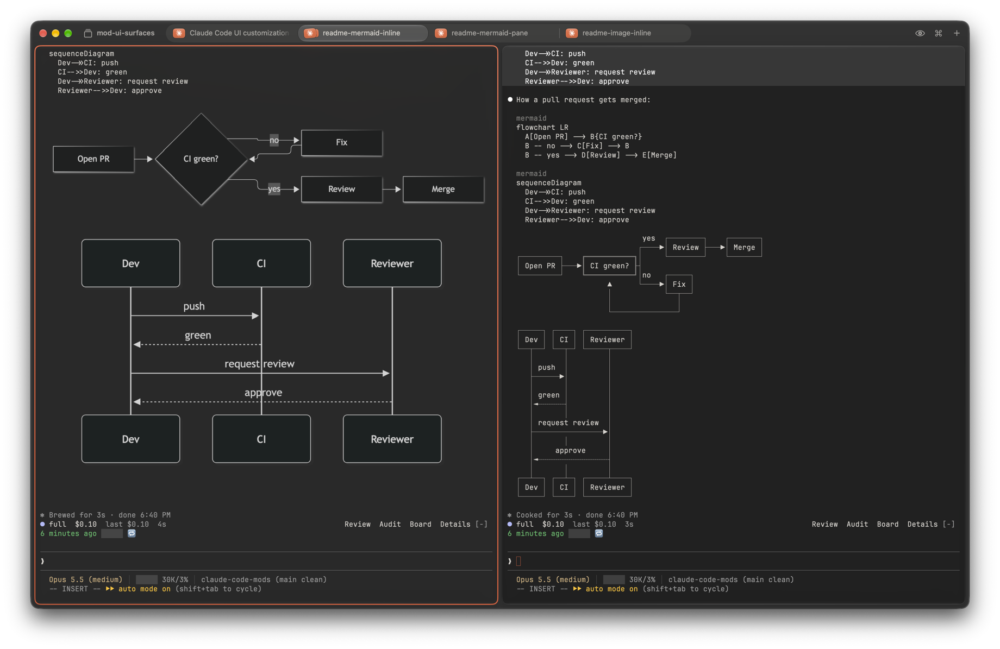
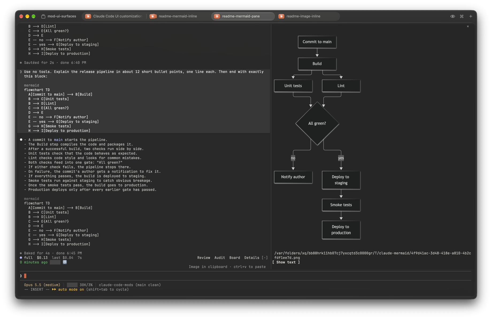
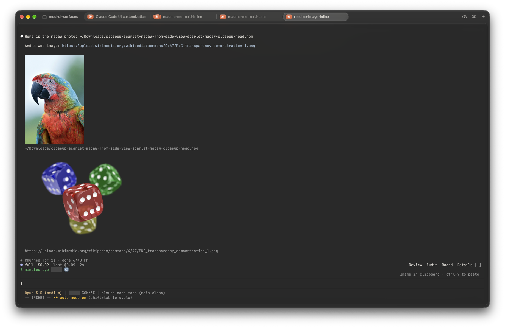

# claude-code-mods

Mods for [Claude Code](https://claude.com/claude-code): hooks modules that change what the terminal UI shows.

| Mod | What it does |
| --- | --- |
| [mermaid](#mermaid) | Draws ````mermaid```` blocks as diagrams, under the reply or in a side pane |
| [image-inline](#image-inline) | Shows the images a reply names (local paths, `file://` and web URLs) under the reply |
| [cache-timer](#cache-timer) | Shows how long ago you last prompted, so you know when the prompt cache expires |

## Install

Inside Claude Code:

```
/plugin marketplace add crierr/claude-code-mods
/plugin install mermaid@claude-code-mods
/plugin install image-inline@claude-code-mods
/plugin install cache-timer@claude-code-mods
/reload-plugins
```

Install only the mods you want. Change their settings with `/config`.

Images need a terminal with inline graphics: kitty, Ghostty, or iTerm2 3.5+ with fullscreen rendering. Other terminals show a text placeholder instead.

## mermaid

Draws each ````mermaid```` block of a reply as a diagram. The reply itself is unchanged: the source stays above the diagram.

**Inline** (the default): each finished diagram is drawn under the reply. Left, image view; right, text view.



**Pane**: the latest diagram is drawn in a side pane, live while the reply streams. `/mermaid` opens or closes it. The **Show text** / **Show image** button (hotkey `v`) switches views.



| Setting | Values | Default |
| --- | --- | --- |
| Where diagrams show | `inline`, `pane (auto-open)`, `pane (/mermaid)` | `inline` |
| View | `text`: Unicode box art. `image`: a PNG made by mermaid-cli | `text` |
| mermaid-cli command | path to `mmdc` | `mmdc` |
| Image theme | `auto` (follows Claude Code's theme, then macOS appearance), `dark`, `light` | `auto` |

- Text view uses [lovely-mermaid](https://github.com/badlogic/pi-mono), bundled. A sideways flowchart that is too wide is redrawn top to bottom.
- Image view needs mermaid-cli: `npm i -g @mermaid-js/mermaid-cli`. PNGs go to `$TMPDIR/claude-mermaid/` and are deleted when the session ends.

## image-inline

When a reply names an image, the image is drawn under the reply, with its path or URL below it.



- Finds markdown images (``), `file://` and `http(s)://` URLs, and bare or relative paths (`~/…`, `./…`). Paths in fenced code blocks are skipped.
- Formats: PNG, JPEG, GIF, WebP, AVIF and SVG. Non-PNG files are converted with macOS `sips`, so on other systems only PNG shows.
- A path that leads to no file draws nothing.
- Web images wait behind a **Load image from …** button by default. Loading downloads with `curl` (20 MB and 20 s limits).
- Converted and downloaded files go to `$TMPDIR/claude-image-inline/` and are deleted when the session ends.

| Setting | Values | Default |
| --- | --- | --- |
| Web images | `ask`: a Load button per image. `always`: fetch at once. `local only`: never fetch | `ask` |
| Image height (rows) | number | `20` |
| Images per reply block | number | `4` |

## cache-timer

A band above the prompt shows how long ago you last sent a prompt:

```
7 minutes ago ░░░░░ 🔁
```

- The text turns from green to yellow in the last 2 minutes before the prompt cache expires, and to red with `(cache expired)` after.
- The bar fills as time passes.
- 🔁 toggles auto-handoff. When on (`->✏️`), a minute before the cache expires the mod writes `.claude/HANDOFF.md` for a fresh session to continue from.

| Setting | Values | Default |
| --- | --- | --- |
| Mode | `default`: show only. `keepwarm`: ping the model 1 minute before expiry. `auto-handoff`: start with handoff on | `default` |
| Cache TTL (seconds) | `300` for a 5-minute cache, `3600` for 1 hour | `300` |
| Max keepwarm pings while idle | number; each ping re-reads the whole context | `6` |

Keepwarm pings and handoffs are model calls, billed like any other request.
