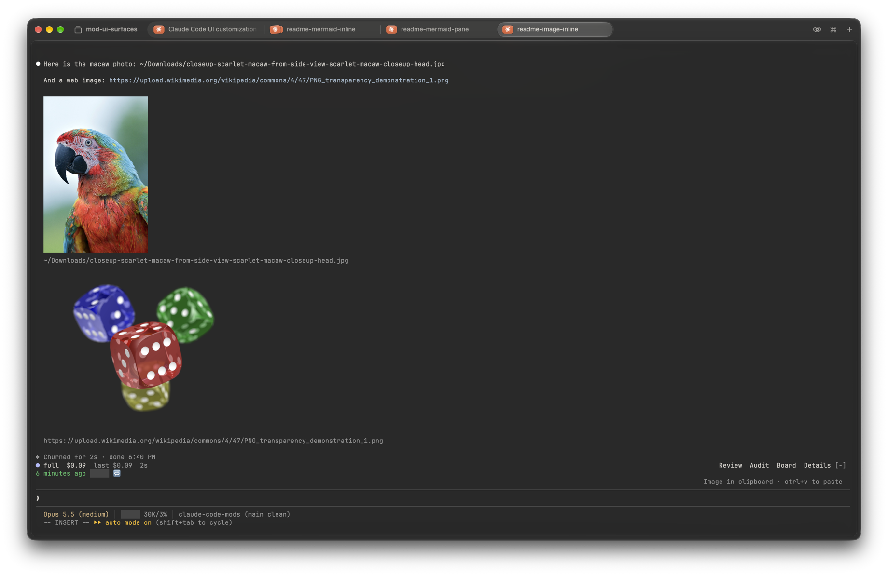
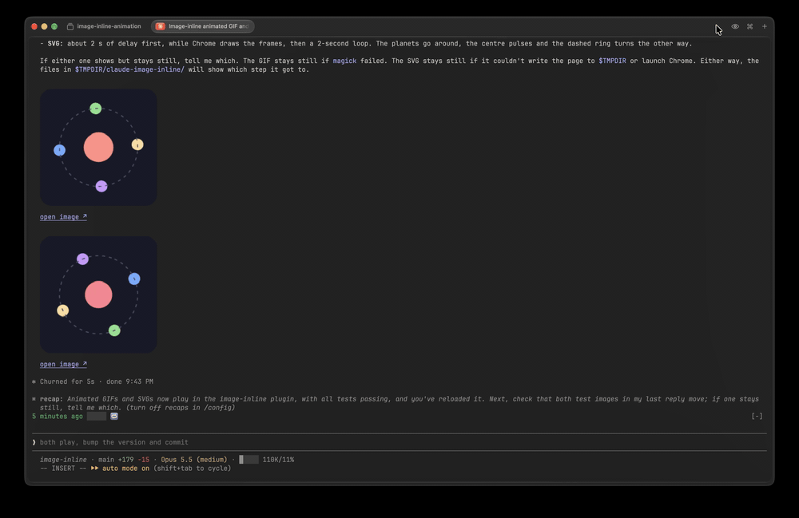

# image-inline

When a reply names an image, the image is drawn under the reply, with buttons below it: **↗ open** opens the file in your image viewer, or the URL in your browser; **⎘ copy** puts the image itself on the clipboard (macOS, or Linux with `wl-copy` or `xclip`).

## Requirements

- A terminal with inline graphics: kitty, Ghostty, or iTerm2 3.5+ with fullscreen rendering. Other terminals show a text placeholder instead.
- **macOS** for anything but PNG: JPEG, GIF, WebP, AVIF and SVG are converted with `sips`, which ships with macOS. On other systems only PNG shows.
- `curl` for web images (preinstalled on macOS and most Linux).
- To play animations: ImageMagick (`magick`) for animated GIFs, plus a Chrome for animated SVGs (Google Chrome, or Playwright's `chromium_headless_shell`). Without them the first frame shows, still.

## Install

```
/plugin marketplace add crierr/crierr-cc
/plugin install image-inline@crierr-cc
/reload-plugins
```

Change settings with `/config`.

## Let Claude know (opt-in)

Claude doesn't know this mod draws images, so it seldom names one for you to see. Add this to your user `~/.claude/CLAUDE.md` (every project; `$CLAUDE_CONFIG_DIR/CLAUDE.md` if you set that), or to a project's `CLAUDE.md` or `AGENTS.md` (that project only). Both load together.

```markdown
This terminal draws images under your replies: an image file named outside code blocks, as a path, a `file://` or https URL, or ``. When you make or find an image worth seeing, such as a screenshot or a chart, name its path.
```

Without it, images show only when a reply happens to name one.

## Usage





- Finds markdown images (``), `file://` and `http(s)://` URLs, and bare or relative paths (`~/…`, `./…`). Paths in fenced code blocks are skipped.
- Formats: PNG, JPEG, GIF, WebP, AVIF and SVG. Non-PNG files are converted with macOS `sips`, so on other systems only PNG shows.
- Animated GIFs play, at their own frame delays. Animated SVGs (SMIL `<animate…>`/`<set>` or CSS `@keyframes`) play too: one headless Chrome run draws up to 60 frames of the loop (its longest duration, 2 s when unknown, 10 s at most). The SVG's own scripts and network loads are blocked while it is drawn.
- A path that leads to no file draws nothing.
- Web images wait behind a **Load image from …** button by default. Loading downloads with `curl` (20 MB and 20 s limits).
- Converted and downloaded files, and animation frames, go to `$TMPDIR/claude-image-inline/` and are deleted when the session ends.

| Setting | Values | Default |
| --- | --- | --- |
| Web images | `ask`: a Load button per image. `always`: fetch at once. `local only`: never fetch | `ask` |
| Image height (rows) | number | `20` |
| Images per reply block | number | `4` |

[← all mods](../../README.md)
