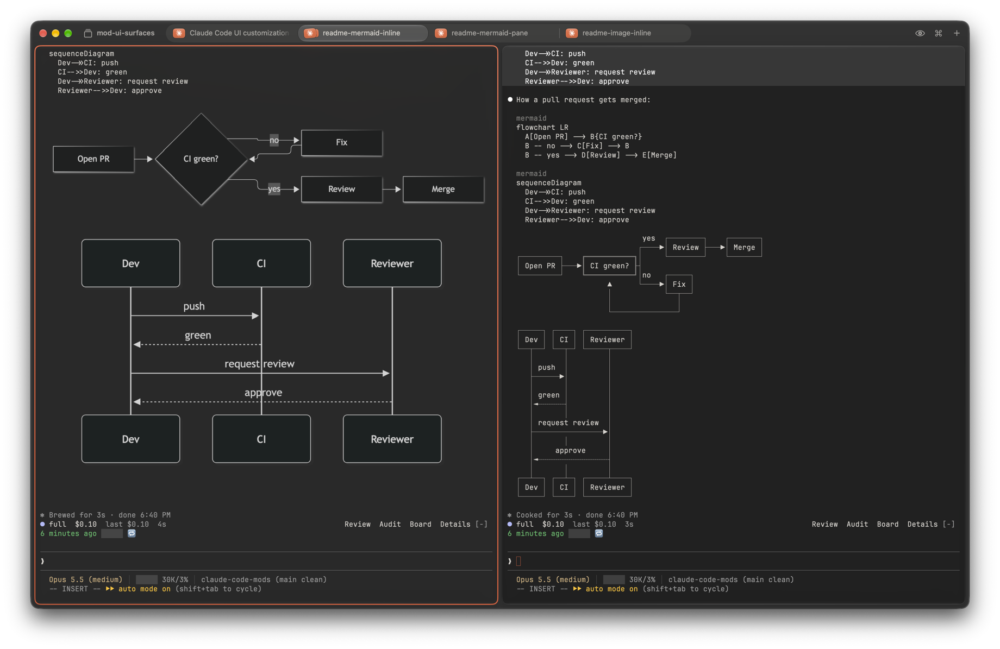

# mermaid

Draws each ````mermaid```` block of a reply as a diagram. Inline in the terminal, the diagram takes the block's place and its source is hidden (a block it can't draw keeps its source); the stored reply, `/copy` and ctrl+o keep the source. A `.mmd` or `.mermaid` file a reply names (`docs/flow.mmd`, `[flow](flow.mmd)`, a `file://` URL) is read and drawn the same way.

Under each inline diagram: **⎘ code** copies its mermaid source; in image view also **↗ open** (the PNG in your image viewer) and **⎘ img** (the PNG itself on the clipboard: macOS, or Linux with `wl-copy` or `xclip`).

## Requirements

- **Text view:** nothing. The lovely-mermaid renderer comes bundled.
- **Image view:** [mermaid-cli](https://github.com/mermaid-js/mermaid-cli) (`mmdc`), which needs Node.js. Install it with `npm i -g @mermaid-js/mermaid-cli`. If `mmdc` isn't on Claude Code's `PATH`, set its full path in the **mermaid-cli command** setting. The install also downloads the headless Chromium that `mmdc` draws with.
- **Image view:** a terminal with inline graphics: kitty, Ghostty, or iTerm2 3.5+ with fullscreen rendering. Other terminals show a text placeholder instead.
- **Image theme auto switch:** reads macOS appearance (`defaults`) when Claude Code's theme doesn't say light or dark. Elsewhere it uses the dark theme; turn auto switch off to override.

## Install

```
/plugin marketplace add crierr/crierr-cc
/plugin install mermaid@crierr-cc
/reload-plugins
```

Change settings with `/config`.

## Let Claude know (opt-in)

Claude doesn't know this mod draws diagrams, so it seldom writes one unprompted. Add this to your user `~/.claude/CLAUDE.md` (every project; `$CLAUDE_CONFIG_DIR/CLAUDE.md` if you set that), or to a project's `CLAUDE.md` or `AGENTS.md` (that project only). Both load together.

```markdown
This terminal draws diagrams under your replies: a ```mermaid block, or the path of a `.mmd` or `.mermaid` file named outside code blocks. When a picture is clearer than prose, include a ```mermaid block; to keep a diagram in the project, write it to a `.mmd` file and name its path instead.
```

Without it, diagrams show only when Claude happens to write Mermaid.

## Usage

Each finished diagram is drawn where its block was (in the desktop and other apps, under the reply). Left, image view; right, text view.



| Setting | Values | Default |
| --- | --- | --- |
| View | `text`: Unicode box art. `image`: a PNG made by mermaid-cli | `text` |
| mermaid-cli command | path to `mmdc`. A wrapper script must not pass its own `-p`: the mod passes `-p` with `{"pipe": true}` (so Chrome exits with mmdc), and mmdc keeps only the last one | `mmdc` |
| Image density | PNG pixels per terminal column: lower draws diagrams bigger, higher smaller. Never wider than the terminal | `16` |
| Image theme: auto switch | on: light or dark theme by Claude Code's theme, then macOS appearance. off: Image theme | on |
| Image light theme | `default`, `forest`, `neutral`, `neo`, `redux`, `redux-color` | `redux-color` |
| Image dark theme | `dark`, `neo-dark`, `redux-dark`, `redux-dark-color` | `redux-dark-color` |
| Image theme | any of the above, used when auto switch is off | `default` |

- Text view uses [lovely-mermaid](https://github.com/badlogic/pi-mono), bundled. A sideways flowchart that is too wide is redrawn top to bottom.
- Image view needs mermaid-cli: `npm i -g @mermaid-js/mermaid-cli`. PNGs go to `$TMPDIR/claude-mermaid/` and are deleted when the session ends.

[← all mods](../../README.md)
